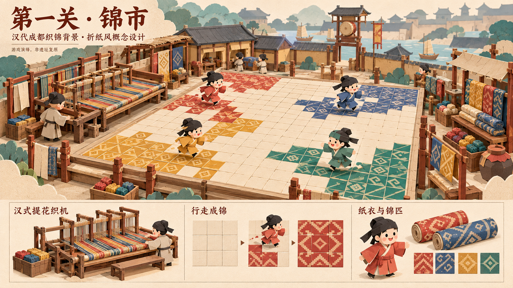

# 第一关「锦市」折纸风概念稿 v1

状态：供视觉与玩法讨论，未定稿；不替代现有关卡规则和布局尺寸。内置 image_gen 生成，完整提示词见 [prompt](01-jinshi-paper-concept-v1.prompt.txt)。

## 视觉与玩法意图

- 汉代成都织锦生产、锦匹交易作为场景背景。左侧织造、右侧售锦，中间保留开阔的跑动区域。
- 延续分队涂色玩法，把踩格染色表现为素色锦面逐步显出连续纹样。四色用于识别队伍，不增加新的织造操作。
- 开局的情绪是兴起、忙碌与热闹；使用暖米白、赭色、深灰环境，突出朱红、靛蓝、黄、绿四色锦纹。
- 折纸、纸雕、立体书共同构成画面语言。纸张是统一美术媒介，不表示汉代建筑、衣服或织机由纸制作。

## 史料参考及演绎边界

1. [中国丝绸博物馆：成都老官山汉墓出土提花织机的复原研究](https://www.chinasilkmuseum.com/cs/info_164.aspx?itemid=28182)：西汉墓葬出土多综提花织机模型；彩色丝线支持先染后织的工艺解释。本稿取用多综、经线与机架的视觉识别点，生成图不是织机结构复原图。
2. [中国国家博物馆：市楼画像砖](https://www.chnmuseum.cn/zp/zpml/kgfjp/202110/t20211028_251942.shtml)：门垣、市楼、悬鼓和交易活动为市井形象参考。本稿将这些元素与织锦作坊组合，为游戏场景设计，不主张存在这一具体历史布局。
3. 沿用总体设计的跨时代叙事：关卡名为「锦市」，背景借用汉代成都织锦业；不据此声称后世十二月市的月份制度已在汉代成立。
4. 踩格成锦是玩法比喻，不表示真实织锦是在织成之后踩踏染色。角色服饰、头巾及锦纹均为简化概念造型，尚需细化核对，不作为具体文物复制。

## 下一轮视觉检查

- 把织机进一步简化为适合游戏镜头的结构，同时保留多综与经线特征。
- 纸衣、纸边和屋顶保持折纸质感，避免场景逐渐偏成真实木制模型。
- 四色锦纹在手机尺寸下应清楚区分归属，不能遮盖格线和角色。
- 主画面只表达构图与氛围；具体格数、出生点和比例以关卡布局细化稿为准。
