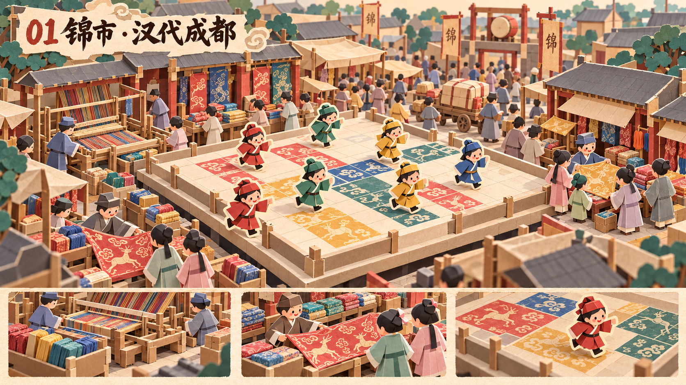

# 锦市 · 汉代成都 · 折纸风概念设计

日期：2026-10-27。状态：**Claude Opus 逐图验收 PASS**，并通过[六关系列终审](reviews/07-series-final-opus.md)。审核只对应指定原图 SHA256，详见[本关报告](reviews/01-jinshi-v3-opus.md)。

## 设计意图

在热闹的织锦贸易区里，以走格成锦完成第一关。左侧早期织机和彩线交代生产，前景展锦、右侧挑锦、后方搬运交代交易；外围人流与中央四色锦面相互衬托。

## 市场活动与时代线索

早期多综织机、彩线束、云气禽兽纹锦、市楼悬鼓；商人展锦议价、顾客挑选、脚夫运货。

## 玩法在画面中的表达

中央四色锦格及带米白剪纸描边的玩家；外围群众在低处连续街面，矮纸栏区分玩法与市场。

## 资料与演绎边界

- [老官山汉墓织机复原研究](https://www.chinasilkmuseum.com/cs/info_164.aspx?itemid=28182)
- [汉晋云气动物纹锦](https://www.chinasilkmuseum.com/zggd/info_21.aspx?itemid=2217)
- [市楼画像砖](https://www.chnmuseum.cn/zp/zpml/kgfjp/202110/t20211028_251942.shtml)

这是汉代成都织锦背景下的锦市演绎，不主张宋代十二月市的月份制度已在汉代原样成立。踩格成锦是玩法比喻，真实织造是先染后织。具体市楼布局、服饰和纹样是简化解释，非文物复制。

## 交付与使用

- [原图](01-jinshi-paper-concept-v3.png)（1672×941，约16:9）。
- [完整生成/修改提示词](01-jinshi-paper-concept-v3.prompt.txt)。使用内置 image_gen；各次修改为独立版本，旧稿保留。
- [逐图 Opus 审核报告](reviews/01-jinshi-v3-opus.md)，包含实际看图方式、评分、可见证据、模型与文件指纹。
- 审核对象是视觉与玩法概念；不是最终模型、正式文案、考古复原或精确关卡布局。图中文字后续应以正式UI重排，微小字形瑕疵不作为贴图资产使用。

全套设计背景与验收条件见[系列简报](series-brief.md)。

