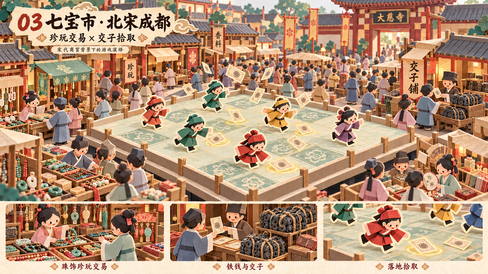

# 七宝市 · 北宋成都 · 折纸风概念设计

日期：2026-10-27。状态：**Claude Opus 逐图验收 PASS**，并通过[六关系列终审](reviews/07-series-final-opus.md)。审核只对应指定原图 SHA256，详见[本关报告](reviews/03-qibaoshi-v1-opus.md)。

## 设计意图

全局商贸繁华的顶点。以大慈寺周边的珍玩、珠饰与交子兑换建立成都联系；珠饰挑选、柜台兑换、钱串搬运和密集街巷共同说明商品与货币如何流动。

## 市场活动与时代线索

大慈寺门匾、交子铺、成捆铁钱、珠串玉饰和珍玩；买卖、兑换、搬运与围摊挑选。

## 玩法在画面中的表达

中央抬高纸台上交子飘落，落地纸票以光圈提示可拾取；外围市场不占用跑动区域。保留现有拾取玩法。

## 资料与演绎边界

- [成都博物馆·“钱眼”看成都](https://www.cdmuseum.com/xinwen/202204/2721.html)
- [成都十二月市与交子背景研究文章](https://news.youth.cn/jsxw/201705/t20170527_9894138.htm)

交子雨是玩法效果，非真实历史事件；图上纸票是统一的游戏符号，不作为北宋交子实物复原。七宝商品品类为解释性组合，不主张唯一清单；寺门也不是具体宋代建筑立面复原。

## 交付与使用

- [原图](03-qibaoshi-paper-concept-v1.png)（1672×941，约16:9）。
- [完整生成/修改提示词](03-qibaoshi-paper-concept-v1.prompt.txt)。使用内置 image_gen；各次修改为独立版本，旧稿保留。
- [逐图 Opus 审核报告](reviews/03-qibaoshi-v1-opus.md)，包含实际看图方式、评分、可见证据、模型与文件指纹。
- 审核对象是视觉与玩法概念；不是最终模型、正式文案、考古复原或精确关卡布局。图中文字后续应以正式UI重排，微小字形瑕疵不作为贴图资产使用。

全套设计背景与验收条件见[系列简报](series-brief.md)。

