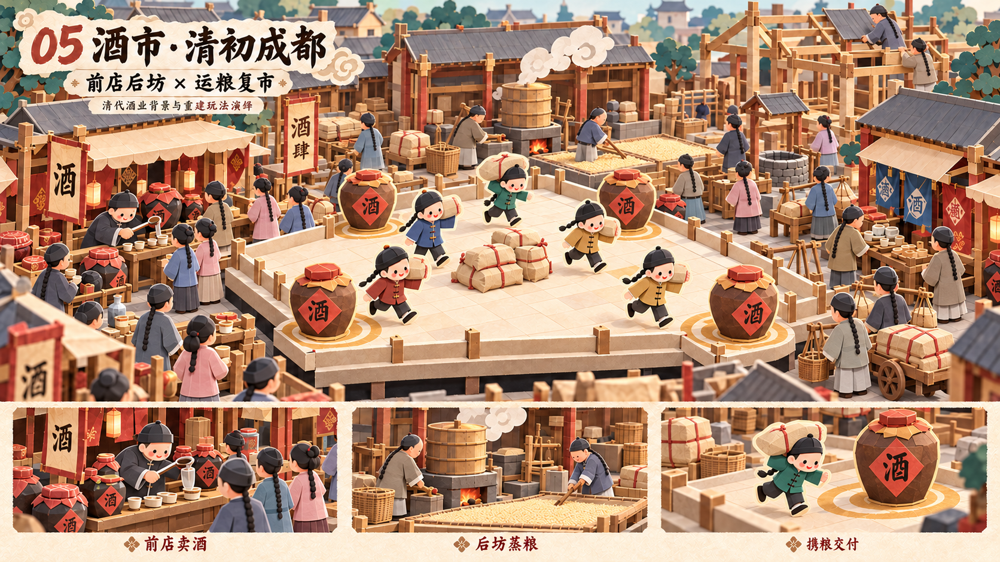

# 酒市 · 清初成都 · 折纸风概念设计

日期：2026-10-27。状态：**Claude Opus 逐图验收 PASS**，并通过[六关系列终审](reviews/07-series-final-opus.md)。审核只对应指定原图 SHA256，详见[本关报告](reviews/05-jiushi-v2-opus.md)。

## 设计意图

复市通过劳动和交易被看见。前店舀酒、试饮、买酒，后坊蒸粮、摊晾、取水；粮运人流与搭建中的屋架表现市场正在恢复。

## 市场活动与时代线索

圆帽、长辫、圆领长衫和短褂；酒坛、粮袋、井、甑与炉灶，前店后坊及纸屋架。女性保持正常发式。

## 玩法在画面中的表达

中央散落粮袋、玩家携袋跑动、四角酒坛交付点和地面圆环，围栏与纸台边界清楚；外围真实工序辅助理解主题。

## 资料与演绎边界

- [水井坊博物馆·遗址复原探析](https://www.sjfmuseum.com/newscontent/id/208)
- [水井街前店后坊及遗址价值](https://sjfmuseum.com/archa/content/id/209)
- [故宫·清代服饰艺术（续）](https://www.dpm.org.cn/embroiders/talk/203177.html)
- [中国丝绸博物馆·清代长袍说明](https://www.chinasilkmuseum.com/cs/info_164.aspx?itemid=28358&parent=)

水井街明清酒坊是成都工艺参考，不宣称图示是清初某次重建的精确布局。粮袋到酒坛是交付符号，非真实一步酿酒；蒸汽来自灶上甑。衣着为概念级清代简化，部分盘扣短装更接近后期常见形式，精确清初服制不在本轮通过范围。

## 交付与使用

- [原图](05-jiushi-paper-concept-v2.png)（1672×941，约16:9）。
- [完整生成/修改提示词](05-jiushi-paper-concept-v2.prompt.txt)。使用内置 image_gen；各次修改为独立版本，旧稿保留。
- [逐图 Opus 审核报告](reviews/05-jiushi-v2-opus.md)，包含实际看图方式、评分、可见证据、模型与文件指纹。
- 审核对象是视觉与玩法概念；不是最终模型、正式文案、考古复原或精确关卡布局。图中文字后续应以正式UI重排，微小字形瑕疵不作为贴图资产使用。

全套设计背景与验收条件见[系列简报](series-brief.md)。

