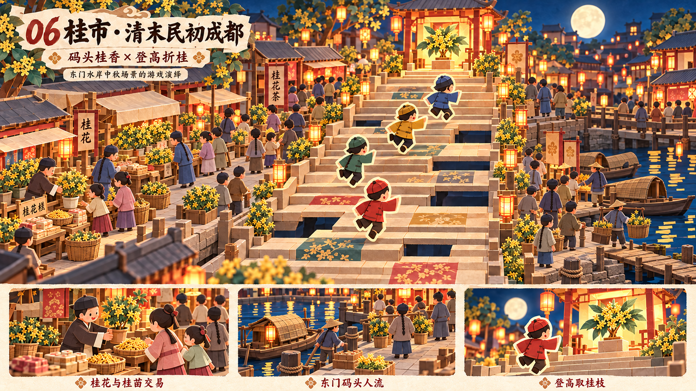

# 桂市 · 清末民初成都 · 折纸风概念设计

日期：2026-10-27。状态：**Claude Opus 逐图验收 PASS**，并通过[六关系列终审](reviews/07-series-final-opus.md)。审核只对应指定原图 SHA256，详见[本关报告](reviews/06-guishi-v2-opus.md)。

## 设计意图

在东门水岸的人流、货运与中秋赏桂中收束全局。桂苗、桂枝、散桂花、茶点交易环绕登高路线，满月与暖灯楼形成团圆的终点。

## 市场活动与时代线索

清式圆帽、长衫短褂、辫发与少量民初短发并见；码头挑夫、篷船、木跳板；阔叶与细小黄花簇组成木犀桂花。

## 玩法在画面中的表达

四名描边玩家沿台阶向暖灯楼与桂枝前进；缺口、下方空间、上升方向和终点清楚，群众留在两侧码头与街面。

## 资料与演绎边界

- [成都市植物园·桂花与成都种植历史](https://chengdubg.org.cn/show-116-390-1.html)
- [故宫·清代服饰艺术（续）](https://www.dpm.org.cn/embroiders/talk/203177.html)
- [中国丝绸博物馆·长袍与晚清变化](https://www.chinasilkmuseum.com/cs/info_164.aspx?itemid=28358&parent=)

东门码头、中秋桂花市场与登楼夺桂是游戏组合，未把历史桂市的确切地点认定为东门码头。灯楼和路线非遗址复原。桂枝使用木犀桂花，不使用西式月桂冠。

## 交付与使用

- [原图](06-guishi-paper-concept-v2.png)（1672×941，约16:9）。
- [完整生成/修改提示词](06-guishi-paper-concept-v2.prompt.txt)。使用内置 image_gen；各次修改为独立版本，旧稿保留。
- [逐图 Opus 审核报告](reviews/06-guishi-v2-opus.md)，包含实际看图方式、评分、可见证据、模型与文件指纹。
- 审核对象是视觉与玩法概念；不是最终模型、正式文案、考古复原或精确关卡布局。图中文字后续应以正式UI重排，微小字形瑕疵不作为贴图资产使用。

全套设计背景与验收条件见[系列简报](series-brief.md)。

